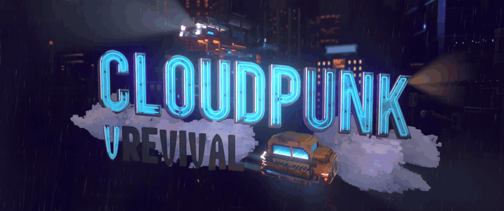
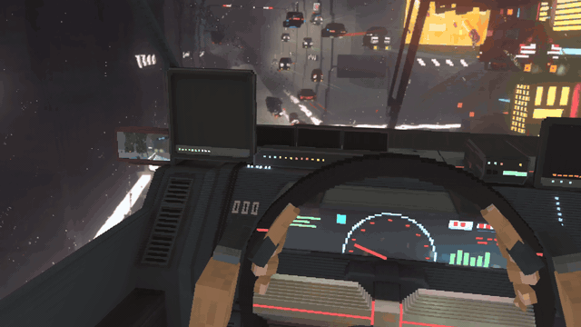
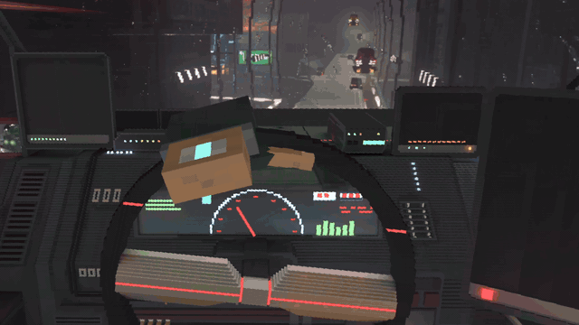

# Cloudpunk VRevival

[](https://github.com/NathanKneT/CloudpunkVRevival/releases) [](LICENSE)



Dive into Cloudpunk, now in VR. Fly the HOVA, run your deliveries, sip your coffee on the dash.
A fan-made VR revival of Cloudpunk on PC: the game you know, made to feel at home in a headset.

Early version: expect rough edges, please report issues.



- sit in the cockpit, grab the wheel, the lift lever and your coffee
- walk around in first person with Rania's own voxel hands, from the start of a new game
- the game's UI on a floating panel, point or look to select
- your jobs and the last lines said to you on Rania's wrist
- the mod's settings right in the pause menu
- tools to film your own shots: clean frame, steady spectator view, free camera
- fixes and comfort options so it plays nice in VR today
- PS VR2: adaptive triggers and eye select with the [PSVR2 Toolkit](https://github.com/BnuuySolutions/PSVR2Toolkit)



Tested on PS VR2. Other headsets have bindings but haven't been tested yet, so please report what works and what doesn't.

## Install

1. Download the latest `CloudpunkVRevival-<version>.zip` from [Releases](https://github.com/NathanKneT/CloudpunkVRevival/releases) and unzip it anywhere
2. Run `INSTALL.bat` (it finds the game on its own and asks before downloading BepInEx)
3. Start SteamVR, then Cloudpunk

No SteamVR running = the game starts flat like normal.

The first launch takes a few minutes with nothing on screen while BepInEx sets itself up: don't close it.

Steam may block the launch with its "Desktop Game Theatre" prompt. Fix: Cloudpunk > Properties > General > untick "Use Desktop Game Theatre while SteamVR is active".

To update: run the new `INSTALL.bat`, your settings stay.

To remove it: `UNINSTALL.bat`. It puts the game files back as Steam installed them and asks whether to remove BepInEx too (other BepInEx mods need it). Your saves are never touched.

## Controls

PS VR2 Sense:

| | |
|---|---|
| Walk / steer | Left stick |
| Turn on foot / climb and dive | Right stick |
| Interact, confirm / back | Cross / Circle |
| Inventory | Triangle |
| The game's free camera in menus | Square |
| Accelerate / brake, reverse | R2 / L2 |
| Strafe, or grab the wheel, lever, coffee or Camus | L1 / R1 |
| Pause menu / map | Options / hold Options |
| Cockpit or outside view, jog while walking | L3 |
| Recenter / show or hide the HUD | R3 / hold R3 |

In menus, point and pull a trigger. With the PSVR2 Toolkit you can also just look at a button and press Cross. On foot, crouch for real to sneak, and reach out with L1 / R1 to take things or talk.

Other controllers: A/B/X/Y for Cross/Circle/Square/Triangle (X/Y are the left A/B on Index), grips for L1/R1 (bumpers on Steam Frame), Menu for Options, stick clicks for L3/R3. The map is View on Steam Frame, and on Index the pause menu and map are the right and left trackpad presses. The in-game prompts show your controller's buttons, and everything can be rebound in SteamVR's controller bindings.

## Settings

In VR, open the pause menu and pick **VREVIVAL**, right under OPTIONS. Changes apply right away and are saved.

| | |
|---|---|
| Wheel sensitivity | How far you turn the wheel for full steer: 25, 35, 50 or 65° |
| HUD on windscreen | The cockpit HUD sits on the windscreen. Off: it follows your head |
| Comfort vignette | Darker edges on hard turns, drops and crashes: off, light, normal, strong |
| Turning on foot | Snap 30, snap 45, smooth, or off to turn with your body |
| First person | First person on foot. Off: the game's camera behind Rania |
| Jog | Click the left stick while walking to jog |
| Crouch to sneak | Crouch for real to sneak |
| HUD distance / size | How far the HUD floats and how big its pieces are |
| Vibration | Off, light, normal, strong |
| Rain | World: drops fall around you. Overlay: the game's streaks. Off |
| Menu sign | VREVIVAL under the main menu's neon sign |
| Skip title screen | No "press any key" at start (after a restart) |
| Mirror quality | The dashboard's rear-view screens: Game, Low, High or Off |
| Rear-view mirror | A mirror under the ceiling beside Camus, try it with Low |

Everything else is in `BepInEx/config/CloudpunkVR.cfg` (made on first launch, edit with the game closed), with a note on each line. The ones worth knowing: `StartInVR` (`Auto`, `Always`, `Never`), `MaxEyeResolution` and `AutoRenderScale` if it stutters, `TrafficDensity` if your CPU struggles, `ButtonPrompts` to force PlayStation or Xbox prompts.

## Filming

- **F2**: clean frame, no HUD in the picture, in VR and flat. The dialogue line stays unless `CleanFrameKeepDialogue = false`. On the main menu it hides the menu for a title shot.
- **F8** in VR: a steady spectator view in the game window instead of the shaky mirror. Grab it with OBS.
- **F6** in the flat game, with `[FreeCam] Enabled = true`: a free camera, in the city or on the main menu. F7 drops a keyframe, F8 plays the path, F5 follows the HOVA, Tab gives the keys back to the game. Shots are small JSON files in `BepInEx/config/CloudpunkVR-shots`: give a keyframe `"t": 4.5` and the take passes it 4.5 s in. On the main menu, `"relightAt": 1.5` relights the sign 1.5 s into each take.
- **F11** on the main menu lights the sign up again.

F2 and F8 only count with the game or OBS in front.

## Known issues

- The sharp mirrors (Mirror quality Low or High, and the rear-view mirror) are opt-in and still being tuned: in flight they don't show the city behind you yet. By default the dashboard screens show the game's own mirror.
- Only PS VR2 has been tested so far.
- Arcade machines and races haven't had a VR pass yet.
- It's heavy: each eye is drawn on its own. If it stutters, lower `MaxEyeResolution` (try 1800) or set the headset to 90 Hz. The log has a `Performance:` line every 30 s.
- Made for Steam build 8245592. Cloudpunk: City of Ghosts isn't supported.

## Bugs

Open an [issue](https://github.com/NathanKneT/CloudpunkVRevival/issues) with your headset and `BepInEx/LogOutput.log`.

## Build

Needs the .NET SDK (6 or later) and Cloudpunk with BepInEx 6 IL2CPP (build 793) launched once, so `BepInEx\interop` exists.

```powershell
tools\build.ps1             # build
tools\build.ps1 -Package    # release zip in artifacts\
tools\install.ps1           # copy the build into the game
```

Game somewhere else? Add `-CloudpunkDir "D:\SteamLibrary\steamapps\common\Cloudpunk"` to `build.ps1` (`install.ps1` finds it, or takes `-GameDir`). `-Dev` builds with the developer commands, don't ship that one. The SteamVR bindings come from `tools/make_bindings.py` and `tools/check_bindings.py` checks them, so don't edit `bindings/*.json` by hand.

## Tests

`tools/test/Run-VRTest.ps1` plays the game on its own through SteamVR's null headset, no headset needed. It follows a step file from `tests/steps`: wait for a log line, send a dev command, grab a headset capture into `tests/captures`. Your mod settings, save and SteamVR config are put back afterwards.

It needs a `-Dev` build and PowerShell 7:

```powershell
tools\build.ps1 -Dev
tools\install.ps1
tools\test\Run-VRTest.ps1 -Steps tests\steps\36-wheel.txt
```

It takes over the screen and closes the game and SteamVR when it's done, so don't run it while playing. Most scenarios continue your last save in the HOVA; the few that need a set spot take `-SaveFixture <folder>`, bring your own save (a folder of .sav files).

## Credits

- ION LANDS for Cloudpunk
- Astienth for [Cloudpunk-VR](https://github.com/Astienth/Cloudpunk-VR), the first Cloudpunk VR mod. Thanks for getting it going!
- [BepInEx](https://github.com/BepInEx/BepInEx), [Il2CppInterop](https://github.com/BepInEx/Il2CppInterop) and [HarmonyX](https://github.com/BepInEx/HarmonyX)
- Valve's [OpenVR SDK](https://github.com/ValveSoftware/openvr)
- BnuuySolutions for the [PSVR2 Toolkit](https://github.com/BnuuySolutions/PSVR2Toolkit)
- the VR modding community

---

Fan-made, not affiliated with ION LANDS. You need your own copy of Cloudpunk. MIT license, see [LICENSE](LICENSE).
